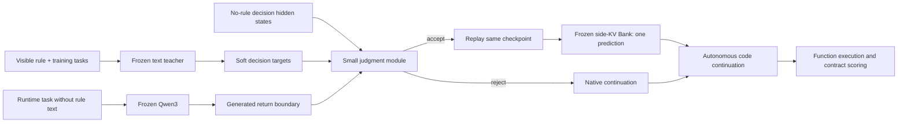

# StateMod

**External Conditional Control of Frozen Language Models**

StateMod is an experimental research project. Its current results demonstrate limited feasibility but do not establish reliable generalization.

A small externally trained judgment module reads a frozen model's hidden state and decides whether to activate a separately compiled latent KV Bank at one Python return-expression decision. This release documents local successes, failed confirmations, and failure analysis. It does not present a reliable general-purpose agent or a successful 14B control loop.

[中文](README.zh-CN.md) · [Technical report](docs/TECHNICAL_REPORT.md) · [Evidence index](experiments/README.md) · [Reproduction scope](reproducibility/REPRODUCE.md)



| Experiment | Observed result | Evidence level |
|---|---|---|
| Cloud03, 8B | AUTO E joint 8/8; N contract 8/8; no new functional regressions | Development, 6 computation families with repeated wording |
| Cloud04, 8B | AUTO E joint 3/16; N contract 3/16 | Attempted independent confirmation; capability/coverage and control criteria failed |
| Cloud06, 8B | MANUAL/AUTO E joint 4/8; AUTO N contract 0/8; two N misactivations | Attempted independent confirmation, 4 new families; not confirmed |
| Cloud10, 14B | Text type selection 8/8; text code E joint 4/4 and N contract 4/4 | Same 8 development tasks; formal baseline-coverage stop retained |
| Cloud11 Attempt02, 14B | Teacher agreement train 8/8, held-out wording 7/8; N rejection 3/4 | Teacher fidelity not established; **no V execution** |
| Cloud12, 14B | Boolean N misactivates after wording change in both bare/fenced formats | Two-task controlled diagnostic, not new natural-generation success |

E denotes tasks where immutable unique members satisfy the user contract and `frozenset` is an external preference. N requires actual caller-side mutation. An E baseline using a correct `set` is not inherently a user-task error.

## What is included

- English and Chinese reports, frozen protocols, prompts, tasks, archived generations and scores, numerical/cost records, and provenance hashes.
- Small 8B/14B judgment checkpoints, the original 8B Bank, and saved hidden states for CPU-only failure replay. Base model weights are **not** included.
- Core readout/gate/scorer and side-KV source. Historical launch scripts are evidence, not a portable one-command GPU reproduction.
- Negative results and the original versus revised Cloud05 scoring are separate.

## Inspect without a GPU

```sh
python -m venv .venv
. .venv/bin/activate
pip install -r requirements-offline.txt
python scripts/verify_release.py
python scripts/reproduce_readout.py
python scripts/recompute_tables.py
python -m unittest discover -s tests -v
```

These commands verify artifacts and recompute archived readouts/counts; they do not train, download a model, or run new inference. They do not turn a failed experiment into a pass. See [what was actually checked](PUBLICATION_CHECKLIST.md).

## Research boundaries

The V Bank adds side attention slots and computational work. The judgment module is teacher-supervised, not a rule interpreter extracted losslessly from text. Python event detection reads generated code. No broad robustness, production safety, zero-context/zero-cost control, or reliable cross-template generalization is established. 8B V results cannot be combined with 14B teacher results to claim a verified larger-model loop.

[Method](docs/METHODOLOGY.md) · [Limitations](docs/LIMITATIONS.md) · [Related work and attribution](docs/RELATED_WORK.md) · [Artifact availability](reproducibility/ARTIFACT_MANIFEST.md)

Author: **myczh**. Project-owned code and documentation use MIT; third-party terms remain applicable. This local preparation is not a published release.
